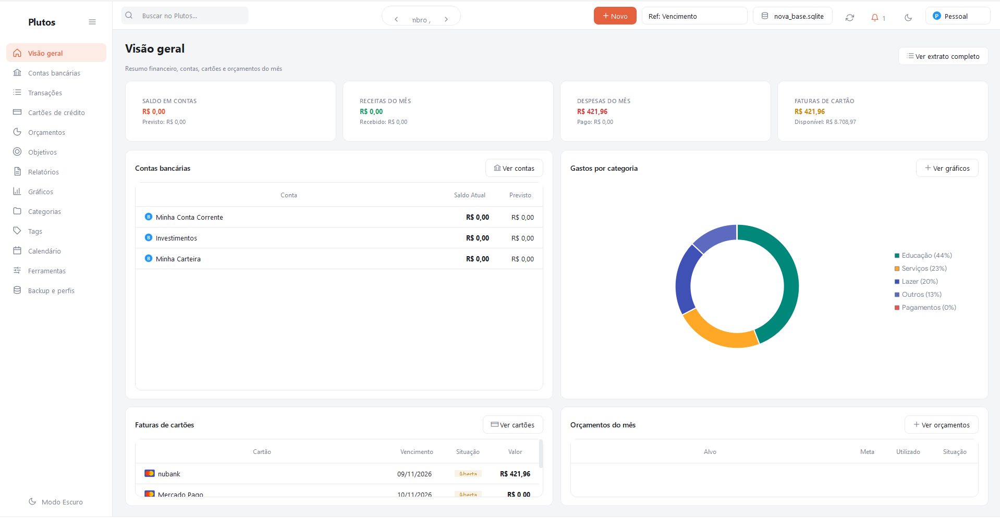
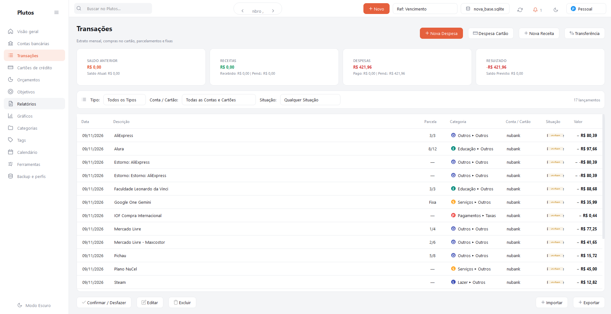
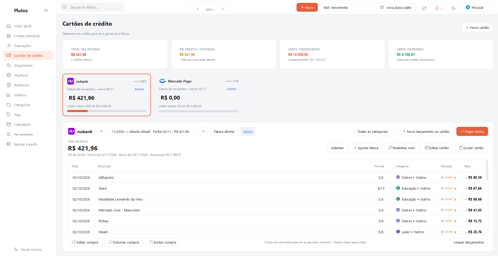
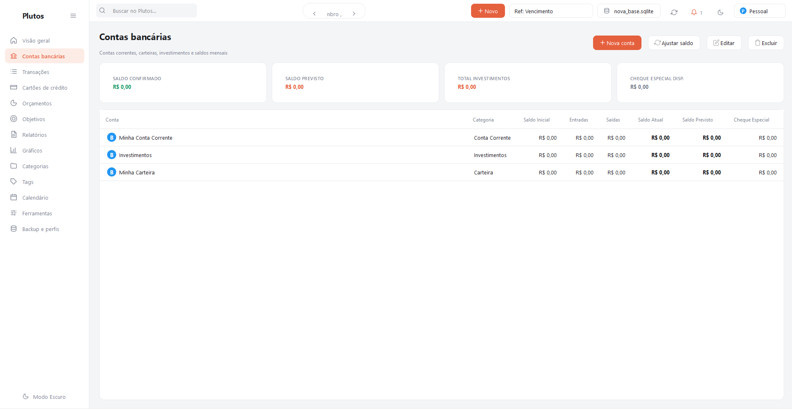
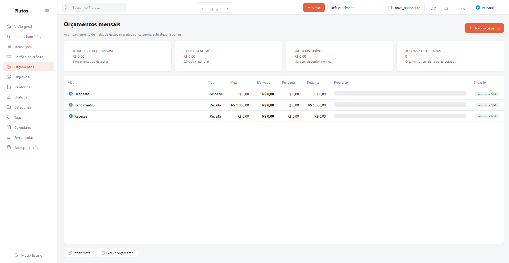
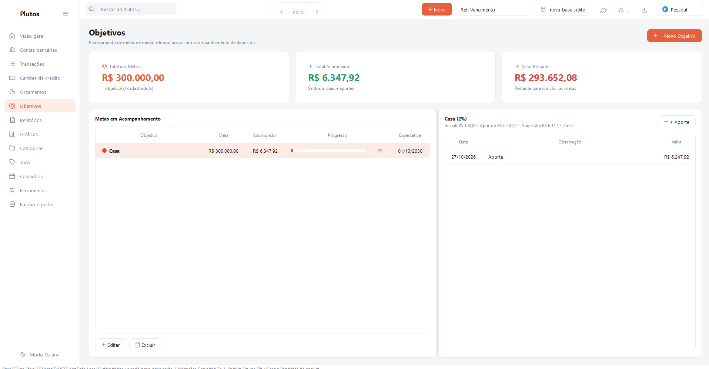
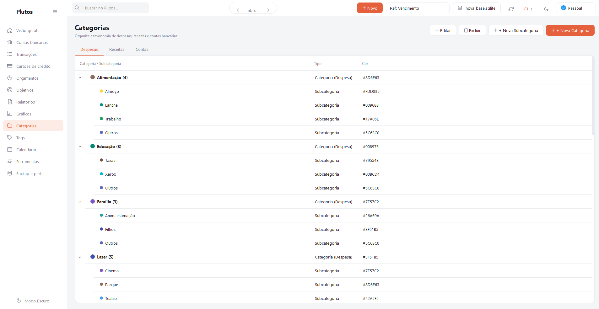
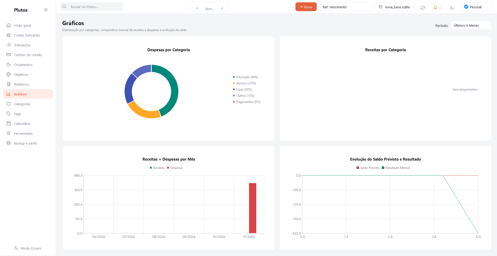
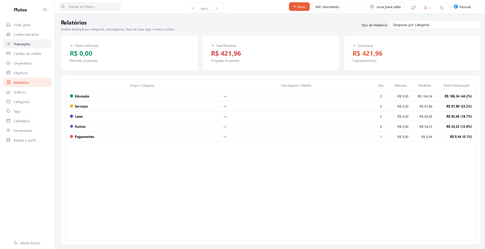
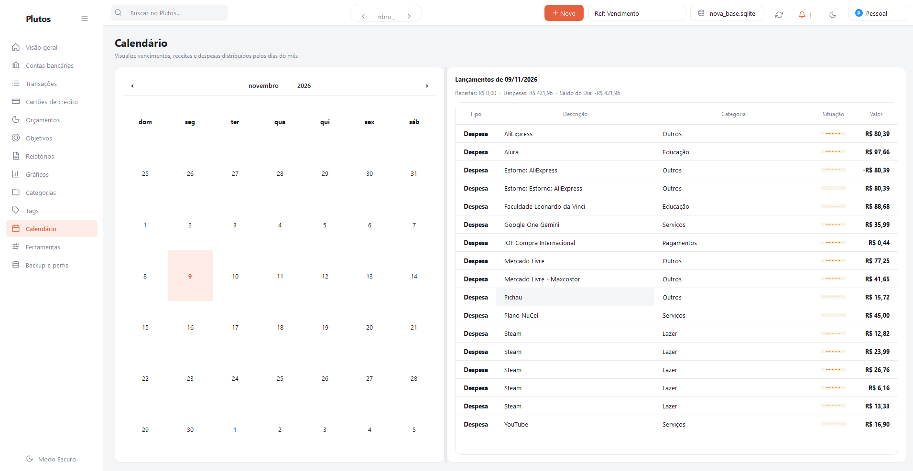

<div align="center">

# 💎 Plutos — Controle Financeiro Pessoal

**O aplicativo desktop nativo definitivo para gestão financeira pessoal com foco em privacidade, elegância e performance.**

[](https://www.python.org/)
[-41CD52?style=for-the-badge&logo=qt&logoColor=white)](https://wiki.qt.io/Qt_for_Python)
[](https://www.sqlite.org/)
[](https://github.com/diogold01/plutosfinances)
[](#-privacidade-e-segurança)

<br/>

<p align="center">
  
</p>

</div>

---

## 📖 Visão Geral

O **Plutos** é uma aplicação desktop nativa moderna desenvolvida em **Python** e **PySide6 (Qt 6)** projetada para oferecer controle total sobre receitas, despesas, cartões de crédito, metas e orçamentos.

Diferente de soluções em nuvem que cobram assinaturas e expõem dados sensíveis, o Plutos opera com arquitetura **Local-First**: **todos os seus dados financeiros pertencem exclusivamente a você e nunca saem do seu computador**.

---

## ✨ Principais Funcionalidades

### 📊 1. Dashboard Financeiro Central
- Visão consolidada de saldo geral acumulado, receitas do mês, despesas pagas e pendentes.
- Gráficos de fluxo de caixa, evolução patrimonial e balanço mensal em tempo real.
- Atalhos rápidos para inclusão de transações e conciliações.

### 💳 2. Gestão Completa de Cartões de Crédito
- Controle independente de múltiplos cartões com limites totais e disponíveis.
- Gestão automática de **data de fechamento**, **data de vencimento** e cálculo do "melhor dia de compra".
- Parcelamento inteligente com projeção automática de faturas futuras.

### 🏦 3. Multicontas e Carteiras
- Suporte a contas correntes, contas poupança, carteiras físicas e contas de investimento.
- Catálogo nativo com **ícones de mais de 100 bancos e instituições financeiras brasileiras**.
- Ajuste rápido de saldo e transferências entre contas com conciliação automática.

### 💸 4. Transações e Lançamentos Flexíveis
- Lançamento de despesas, receitas e transferências com categorias e subcategorias.
- Suporte a recorrências, despesas fixas, parcelamentos e transações pendentes/efetivadas.
- Sistema de **Tags** transversais para rastreamento de projetos, eventos e viagens.

### 🎯 5. Metas e Objetivos Financeiros
- Criação de objetivos com valor-alvo, prazo estimado e acompanhamento percentual de progresso.
- Histórico de aportes e resgates vinculados diretamente a contas e investimentos.

### 📑 6. Orçamentos Mensais Inteligentes
- Definição de limites de gastos por categoria (Alimentação, Moradia, Lazer, etc.).
- Barras de progresso com alertas visuais de proximidade e estouro de orçamento.

### 🗓️ 7. Visão em Calendário
- Calendário financeiro interativo para visualização de vencimentos de faturas, contas a pagar e receitas previstas dia a dia.

### 📁 8. Importação e Exportação (I/O Inteligente)
- Importação rápida de extratos bancários via arquivos **CSV** e planilhas **Excel (.xlsx)**.
- Mecanismo anti-duplicidade inteligente para evitar lançamentos repetidos.
- Exportação de relatórios para auditoria e análises externas.

### 🔒 9. Privacidade e Segurança Máxima
- **100% Offline e Local**: Banco de dados SQLite rápido e confiável no seu próprio computador.
- **Proteção por PIN**: Opção de bloqueio da aplicação por senha/PIN na inicialização.
- **Rotina de Backup Automático**: Agendamento em segundo plano e restauração simples de cópias de segurança com 1 clique.

---

## 🖼️ Demonstração Visual das Telas

<div align="center">
  <table>
    <tr>
      <td width="50%">
        
        <p align="center"><b>Lançamentos e Transações</b></p>
      </td>
      <td width="50%">
        
        <p align="center"><b>Cartões de Crédito e Faturas</b></p>
      </td>
    </tr>
    <tr>
      <td width="50%">
        
        <p align="center"><b>Gestão de Contas e Bancos</b></p>
      </td>
      <td width="50%">
        
        <p align="center"><b>Orçamentos por Categoria</b></p>
      </td>
    </tr>
    <tr>
      <td width="50%">
        
        <p align="center"><b>Objetivos e Metas Financeiras</b></p>
      </td>
      <td width="50%">
        
        <p align="center"><b>Categorias e Subcategorias</b></p>
      </td>
    </tr>
    <tr>
      <td width="50%">
        
        <p align="center"><b>Gráficos e Estatísticas</b></p>
      </td>
      <td width="50%">
        
        <p align="center"><b>Relatórios e Fluxo de Caixa</b></p>
      </td>
    </tr>
    <tr>
      <td colspan="2" align="center">
        
        <p align="center"><b>Visão em Calendário de Vencimentos</b></p>
      </td>
    </tr>
  </table>
</div>

---

## 🏗️ Arquitetura do Projeto

O Plutos foi estruturado seguindo princípios de **Clean Architecture** e **Domain-Driven Design (DDD)**, garantindo separação rígida de responsabilidades:

```text
Minhas Finanças/
├── app/
│   ├── assets/                 # Ícones de bancos, SVGs, fontes e scripts SQL
│   ├── config/                 # Configurações do app, paleta de cores e temas
│   ├── database/               # Gerenciador de conexão SQLite, migrations e backups
│   │   └── repositories/       # Padrão Repository (Accounts, Categories, Tags, etc.)
│   ├── domain/                 # Entidades de negócio e regras de domínio
│   │   └── services/           # Serviços (Transactions, Cards, Analytics, Budgets)
│   ├── io_module/              # Manipulação de CSV, Excel e checagem de duplicatas
│   ├── ui/                     # Interface gráfica em PySide6
│   │   ├── components.py       # Widgets reutilizáveis (cards, inputs, badges)
│   │   ├── style_manager.py    # Gerenciador de temas dinâmicos (Dark / Light)
│   │   └── views/              # Telas da aplicação (Dashboard, Cartões, Contas, etc.)
│   ├── main.py                 # Ponto de entrada da aplicação
│   └── version.py              # Versão oficial centralizada do sistema
├── docs/                       # Documentação técnica e regras de compilação
│   └── rules/                  # Regras de versionamento e build
├── installer/                  # Script oficial do instalador Windows Inno Setup
├── referencias/                # Material visual e referências de design
│   └── ref-plutos/             # Capturas de tela oficiais da aplicação
├── scripts/                    # Scripts utilitários de geração de assets e demos
├── tests/                      # Suíte de testes automatizados unitários e de integração
└── build_executable_and_installer.ps1 # Script de automação de build e release
```

---

## 🚀 Como Executar em Desenvolvimento

### Pré-requisitos
- **Python 3.10 ou superior** instalado ([Download oficial](https://www.python.org/))
- **Git** instalado

### Passo a Passo

1. **Clone o repositório:**
   ```bash
   git clone https://github.com/diogold01/plutosfinances.git
   cd plutosfinances
   ```

2. **Crie e ative um ambiente virtual (recomendado):**
   ```bash
   # No Windows (PowerShell)
   python -m venv .venv
   .\.venv\Scripts\Activate.ps1
   ```

3. **Instale as dependências:**
   ```bash
   pip install PySide6 pytest openpyxl
   ```

4. **Inicie a aplicação:**
   ```bash
   python -m app.main
   ```

---

## 🧪 Testes Automatizados

O Plutos conta com uma suíte de testes automatizados cobrindo banco de dados, regras de negócio, cálculo de faturas, orçamentos e importação/exportação:

```bash
# Executar todos os testes
pytest -v tests
```

---

## 📦 Compilação do Executável e Instalador Windows

Para compilar o aplicativo em um executável autônomo (`.exe`) e gerar o instalador de distribuição via **Inno Setup**:

1. Certifique-se de que o PyInstaller está instalado:
   ```bash
   pip install pyinstaller
   ```
2. Execute o script de automação oficial:
   ```powershell
   powershell -ExecutionPolicy Bypass -File .\build_executable_and_installer.ps1 -Version "1.3.6"
   ```
3. Os binários gerados serão salvos em:
   - `dist/Plutos/Plutos.exe` (Executável standalone)
   - `dist/Instalador/Plutos_Setup_1.3.6.exe` (Instalador com assistente)

---

## 🛡️ Licença e Privacidade

- **Dados 100% Locais:** Não há telemetria invasiva, envio de dados bancários para servidores externos nem necessidade de conexão constante com a internet.
- Desenvolvido para oferecer máxima autonomia financeira pessoal com tecnologia de ponta.

---

<div align="center">
  <b>Plutos</b> — Inteligência e controle total para a sua vida financeira.
</div>
