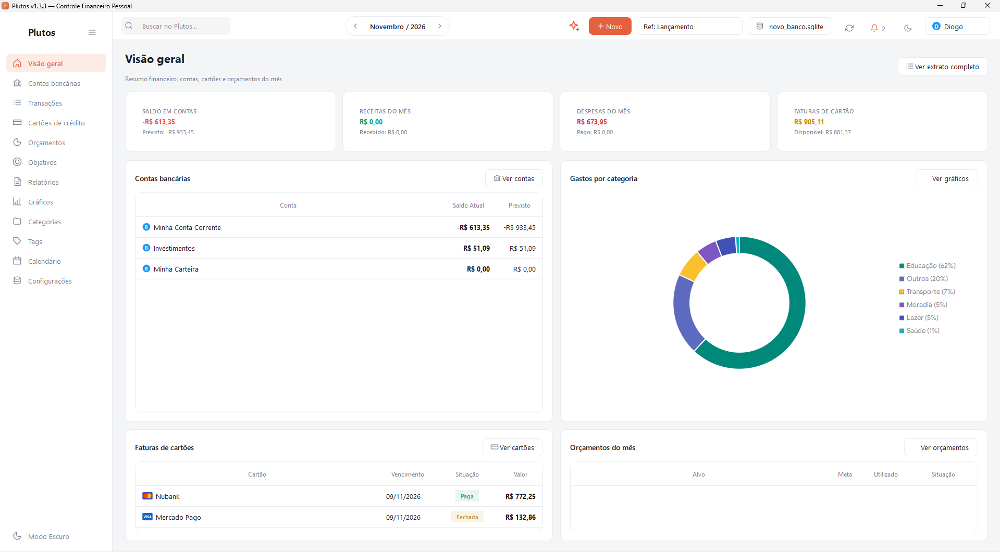
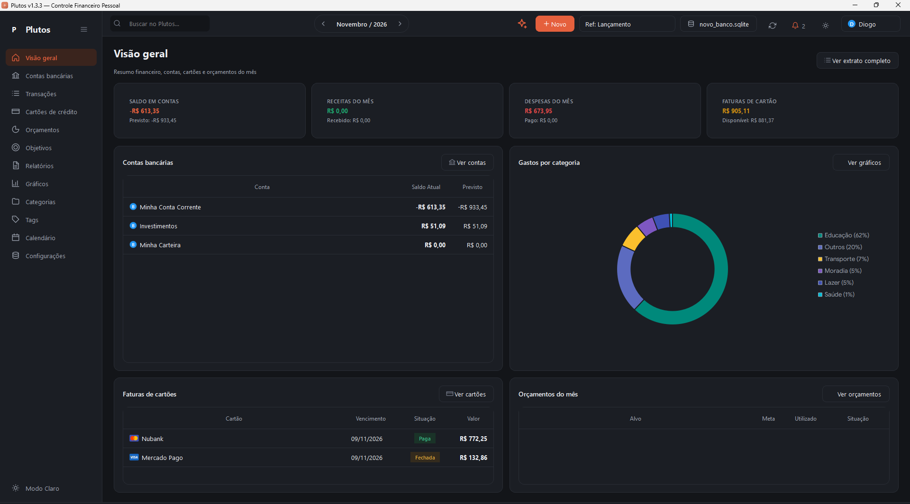
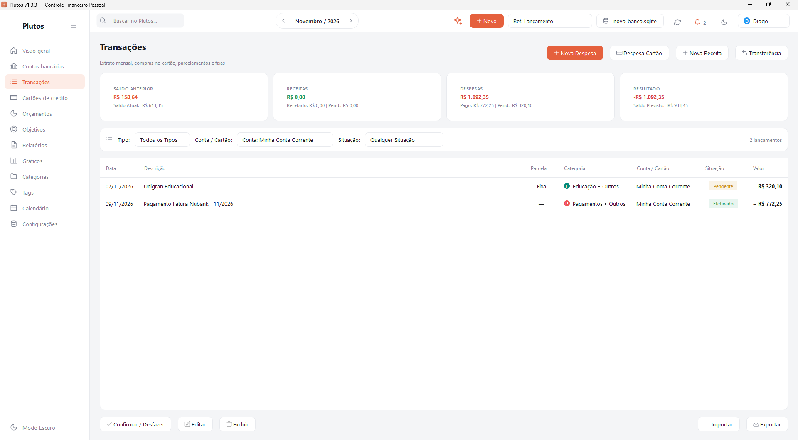
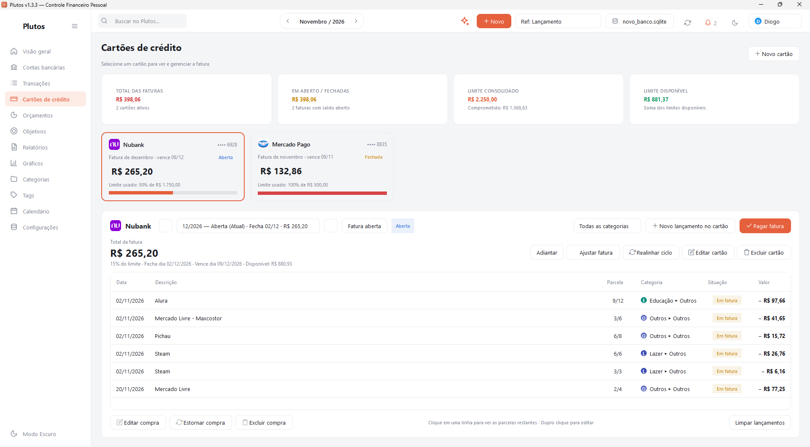
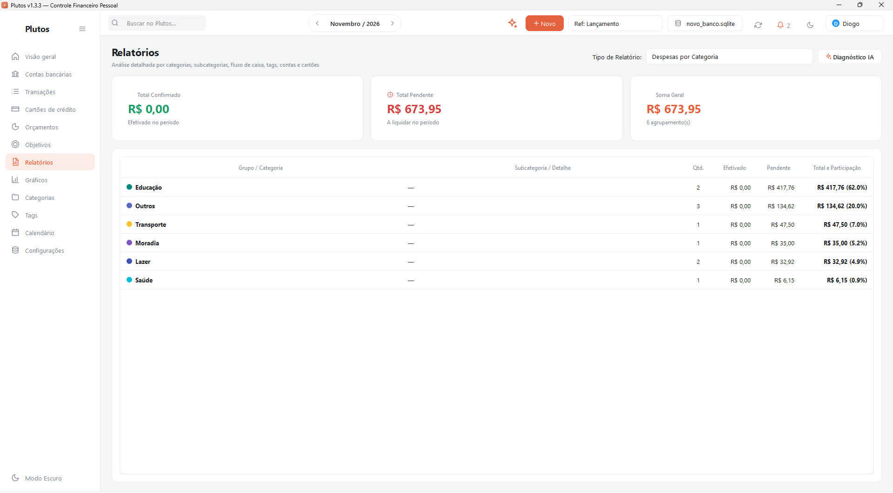
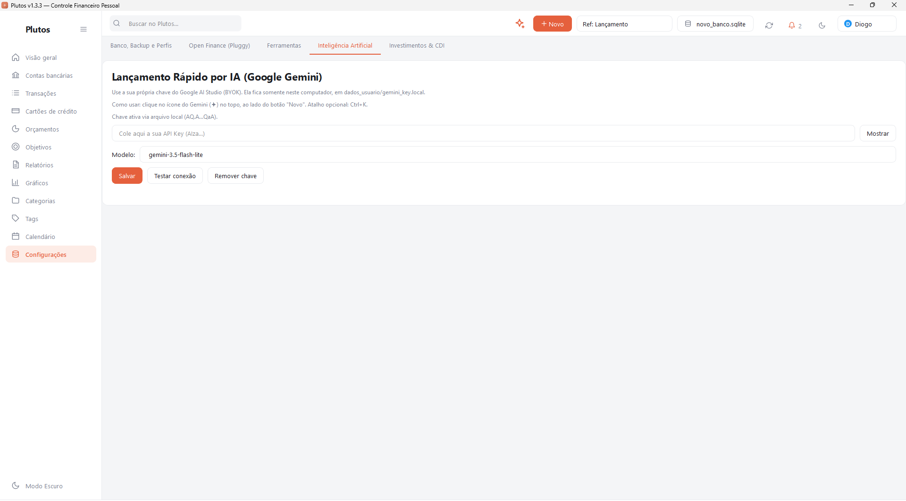

# Plutos — Controle Financeiro Pessoal

Aplicação desktop para Windows voltada ao controle de despesas, receitas, cartões de crédito, contas bancárias, metas e investimentos, com armazenamento local em SQLite e recursos opcionais de inteligência artificial via Google Gemini.

<p align="center">
  
  
</p>

---

## O Problema e a Solução

Planilhas financeiras tradicionais costumam ser abandonadas pela fricção de preencher vários campos para cada pequeno gasto do dia a dia. Por outro lado, aplicativos móveis nem sempre oferecem visão analítica detalhada de faturas de cartão, parcelamentos e caixinhas de investimento no computador.

O Plutos combina o registro rápido de gastos por interpretação de texto com um painel desktop completo salvo localmente no computador do usuário.

---

## Como a IA Funciona (Google Gemini)

O uso de IA é opcional (modelo BYOK — o usuário informa sua própria chave do Google AI Studio) e atua em duas frentes:

### 1. Lançamento por Interpretação de Texto (`Ctrl+K` ou `Ctrl+J`)
Permite digitar frases simples do cotidiano (uma ou várias por vez), como:
- `"Almoço 45,90 no débito Nubank"`
- `"Salário 4800 no Itaú dia 05"`
- `"Cinema 60 cartão Inter 2x"`

O serviço envia o texto digitado e a lista de categorias/contas cadastradas para o modelo `gemini-3.5-flash-lite`, preenchendo automaticamente descrição, valor, tipo, meio de pagamento, conta/cartão, parcelas e categoria em uma tela de prévia para revisão humana antes de gravar no banco SQLite. Caso a IA não identifique algum campo ou esteja desligada, um analisador local preenche os dados básicos.

### 2. Diagnóstico Orçamentário (Regra 50-30-20)
Na aba **Relatórios**, o botão **Diagnóstico IA** avalia a divisão mensal entre gastos essenciais (50%), estilo de vida (30%) e investimentos/reservas (20%), apontando desvios em relação aos meses anteriores. Para preservar a privacidade, apenas os totais consolidados por categoria são enviados no prompt, sem transmitir o histórico individual de transações.

---

## Funcionalidades Principais

- **Dashboard:** visão de saldo geral, receitas, despesas, faturas abertas e distribuição por categoria.
- **Cartões de crédito:** controle de limites, fechamento, vencimento, compras parceladas e pagamento de fatura vinculado à conta corrente.
- **Contas e CDB:** acompanhamento de contas bancárias, carteira física e projeção de rendimento de CDB em dias úteis.
- **Orçamentos e metas:** definição de limites mensais por categoria e metas de economia com cálculo de aporte mensal.
- **Importação e exportação:** leitura de extratos em CSV com verificação de duplicidade, exportação de relatórios para Excel (`.xlsx`) e CSV, e cópias automáticas de backup local do arquivo SQLite.
- **Múltiplos perfis:** separação de bancos locais por perfil com bloqueio opcional por PIN.

---

## Telas da Aplicação

<p align="center">
  
  
</p>
<p align="center">
  
  
</p>

---

## Limites Atuais

- O banco de dados é exclusivamente local em SQLite no Windows (não possui sincronização em nuvem entre dispositivos).
- Os recursos de interpretação de texto e diagnóstico dependem de conexão à internet e de uma chave própria da API Google Gemini configurada pelo usuário.

---

## Stack

- Python 3.10+
- PySide6 (interface gráfica desktop Qt 6)
- SQLite (banco de dados local)
- Google Gemini API (`gemini-3.5-flash-lite` via chamadas REST)
- OpenPyXL (exportação de planilhas `.xlsx`)

---

## Como Executar Localmente

```powershell
git clone https://github.com/diogold01/plutosfinances.git
cd plutosfinances
python -m venv .venv
.\.venv\Scripts\Activate.ps1
pip install PySide6 openpyxl pytest
python -m app.main
```

Para rodar os testes automatizados em modo sem janela gráfica:
```powershell
$env:QT_QPA_PLATFORM="offscreen"
py -m pytest tests
```

Para gerar o executável e o instalador Windows (versão atual `1.3.3`):
```powershell
pip install pyinstaller
powershell -ExecutionPolicy Bypass -File .\build_executable_and_installer.ps1 -Version "1.3.3"
```
