<div align="center">

# Plutos — Controle Financeiro Pessoal

**Aplicação desktop para gestão financeira pessoal com arquitetura local-first em Python e Qt 6 (PySide6).**

[](https://www.python.org/)
[-41CD52?style=flat&logo=qt&logoColor=white)](https://wiki.qt.io/Qt_for_Python)
[](https://www.sqlite.org/)
[](https://github.com/diogold01/plutosfinances)
[](tests/)
[](https://github.com/diogold01/plutosfinances/releases)

<br/>

<p align="center">
  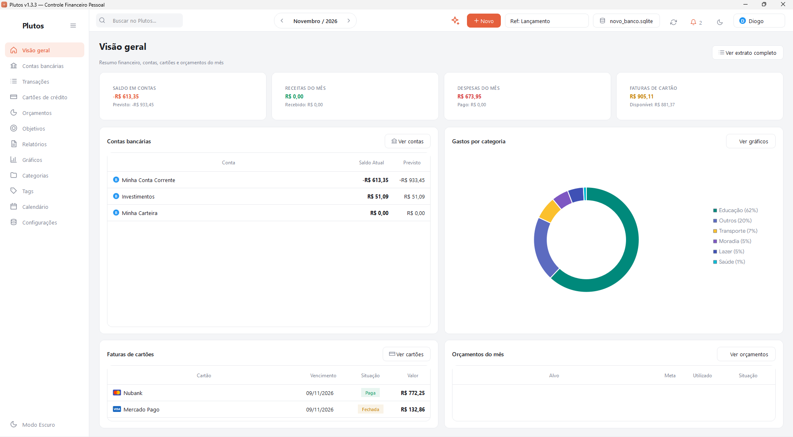
  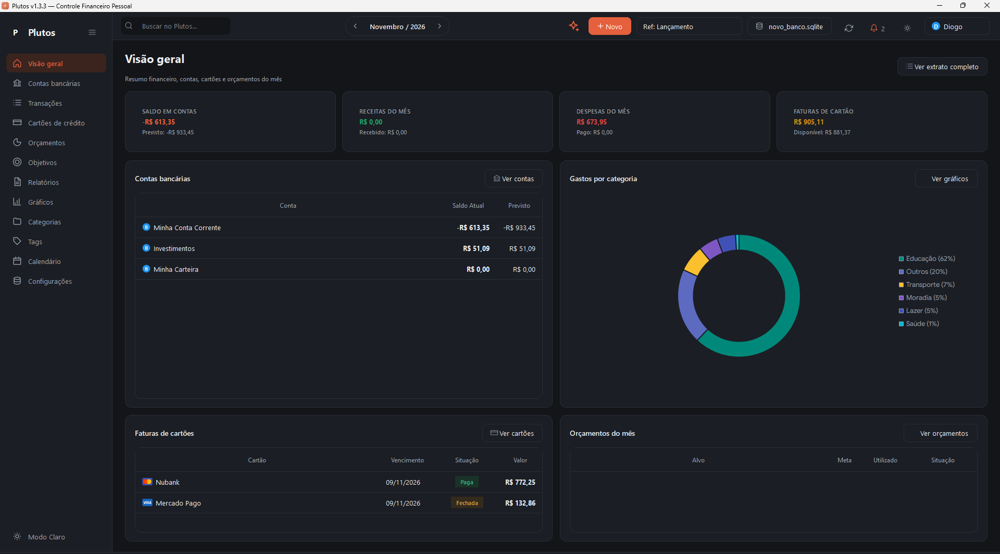
</p>
<p align="center"><i>Painel principal com suporte nativo a temas claro e escuro</i></p>

</div>

---

## Visão Geral

O **Plutos** é um gerenciador financeiro desktop para Windows projetado para controle completo de despesas, receitas, cartões de crédito, contas bancárias, metas e investimentos.

- **Arquitetura Local-First:** Os dados ficam armazenados localmente em banco **SQLite** (`.sqlite`), sem telemetria, sem necessidade de cadastro e com funcionamento offline por padrão.
- **Lançamento Rápido por Texto (IA opcional):** Permite registrar despesas digitando frases simples em linguagem natural (ex.: *"almoço 45 reais débito nubank"*), interpretadas via API do Google Gemini com chave própria (BYOK).
- **Diagnóstico Orçamentário (50-30-20):** Relatório analítico mensal com cálculo de conformidade com a regra 50-30-20 (gastos essenciais, estilo de vida e investimentos) e identificação de anomalias em relação aos meses anteriores.
- **Rendimento de CDB automático:** Projeção diária de rendimento (% do CDI) calculada sobre dias úteis bancários (convenção 252 da B3).
- **Confiabilidade:** Suíte de **97 testes automatizados** cobrindo regras de negócio financeiras, faturas, cálculo de juros e interface gráfica offscreen.

---

## Privacidade e Armazenamento

- **Banco de dados local:** Todas as transações, contas e categorias são salvas exclusivamente no arquivo SQLite local.
- **Backup a quente no disco:** O recurso de backup utiliza a API `sqlite3.backup` para gerar cópias locais do banco de dados na pasta `dados_usuario/backups/`, retendo as 6 versões mais recentes. Nenhum dado é enviado para a nuvem.
- **Uso de rede (apenas com autorização explícita):**
  - **Google Gemini (BYOK):** Ao usar o atalho de lançamento inteligente (`Ctrl+K`) ou o Diagnóstico Financeiro, apenas o texto inserido ou os totais consolidados do mês e os nomes das categorias são enviados à API. O histórico completo do banco e dados sensíveis não são transmitidos.
  - **Open Finance (Pluggy):** Integração opcional para leitura de extratos bancários com credenciais próprias da Pluggy, sempre com confirmação manual antes da gravação local.

---

## Integração com IA (Google Gemini)

### 1. Lançamento por Linguagem Natural (`Ctrl+K` ou `Ctrl+J`)

Permite cadastrar lançamentos rápidos a partir de texto informal:

- *"Almoço executivo 45,90 no débito Nubank"*
- *"Salário 4800 no Itaú dia 05"*
- *"pão 12 padaria no dinheiro"*
- *"Cinema 60 cartão Inter 2x"*

Suporta múltiplos lançamentos (um por linha) e abre uma tela de conferência para revisão e edição dos campos antes da gravação no banco de dados.

### 2. Diagnóstico Financeiro (Regra 50-30-20)

Disponível na aba **Relatórios** através do botão **Diagnóstico IA**:
- **Score financeiro (0 a 100):** Avaliação calculada com base na taxa de poupança e controle de gastos.
- **Distribuição orçamentária:**
  - Gastos Essenciais (meta até 50%): moradia, alimentação, saúde, contas fixas.
  - Estilo de Vida (meta até 30%): lazer, restaurantes, compras eventuais.
  - Poupança e Investimentos (meta mínima 20%): aportes, caixinhas CDB e reservas.
- **Detecção de anomalias:** Identifica variações expressivas de gastos em relação à média dos últimos 2 meses.
- **Recomendações práticas:** Sugestões pontuais de ajuste orçamentário para o período seguinte.

### Configuração da Chave de API (BYOK)

A integração utiliza o modelo `gemini-3.5-flash-lite` via API REST gratuita do Google AI Studio. A chave pode ser configurada de três formas:

1. **Interface:** Em **Configurações → Inteligência Artificial**.
2. **Arquivo local:** Criando `dados_usuario/gemini_key.local` (ignorado pelo Git).
3. **Variável de ambiente:**
   ```powershell
   $env:GEMINI_API_KEY = "sua_chave_aqui"
   ```

---

## Funcionalidades

- **Dashboard:** Visão consolidada de saldo geral, receitas, despesas, faturas em aberto e gráfico de distribuição por categoria.
- **Cartões de crédito:** Controle de limites, cálculo de fechamento e vencimento, parcelamentos futuros e quitação vinculada à conta corrente.
- **Contas bancárias e CDB:** Gestão de contas correntes, carteiras e investimentos, com cálculo diário de rendimento de caixinhas CDB (% CDI em dias úteis).
- **Lançamentos e conciliação:** Registro de despesas, receitas, transferências, parcelamentos, rateio multi-categoria e tags transversais (`#tag`).
- **Orçamentos:** Limites mensais por categoria com alertas visuais de margem.
- **Metas e objetivos:** Acompanhamento de metas financeiras com cálculo de aporte mensal sugerido.
- **Gráficos analíticos:** Despesas por categoria, receitas, comparativo mensal e evolução do saldo via QtCharts.
- **Relatórios:** Tabelas analíticas de despesas, receitas, fluxo de caixa e exportação para Excel (`.xlsx`) e CSV.
- **Importação de extratos:** Leitor de extratos em CSV com detecção de duplicatas por hash SHA-256 e mapeador configurável de colunas.
- **Calendário:** Visualização mensal dos vencimentos de contas e faturas.
- **Segurança e perfis:** Suporte a múltiplos perfis locais com proteção opcional por PIN (hash SHA-256).

---

## Galeria de Telas

<div align="center">
  <table>
    <tr>
      <td width="50%">
        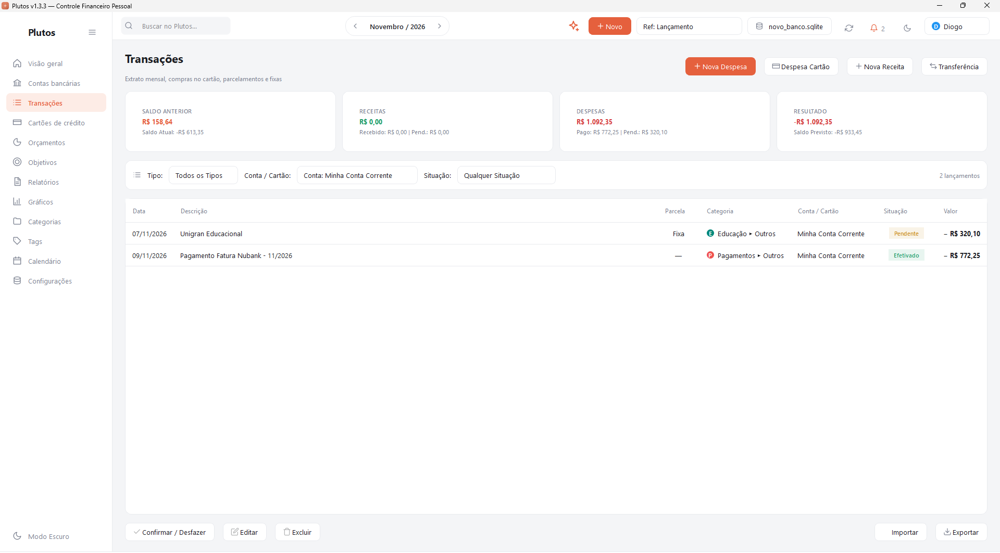
        <p align="center"><b>Lançamentos e Transações</b></p>
      </td>
      <td width="50%">
        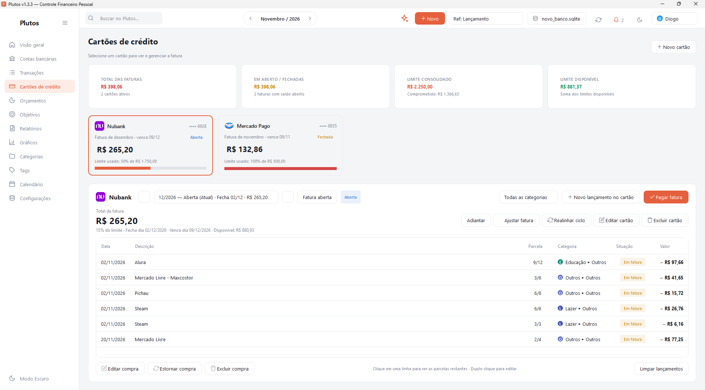
        <p align="center"><b>Cartões de Crédito e Faturas</b></p>
      </td>
    </tr>
    <tr>
      <td width="50%">
        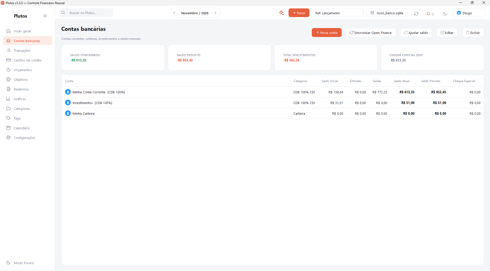
        <p align="center"><b>Contas Bancárias e Caixinhas CDB</b></p>
      </td>
      <td width="50%">
        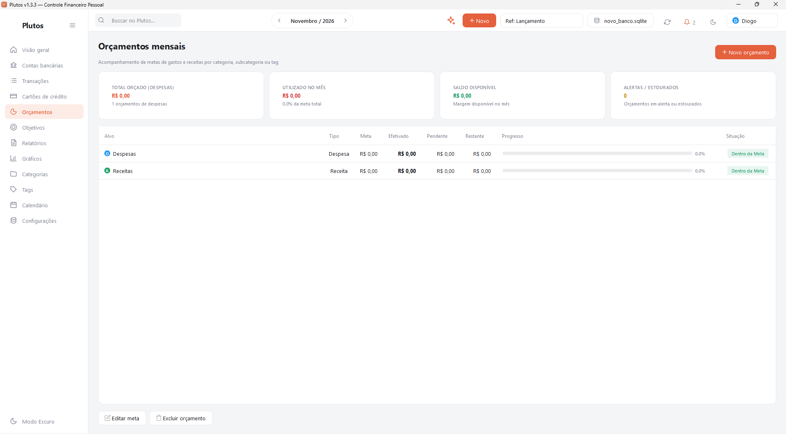
        <p align="center"><b>Orçamentos por Categoria</b></p>
      </td>
    </tr>
    <tr>
      <td width="50%">
        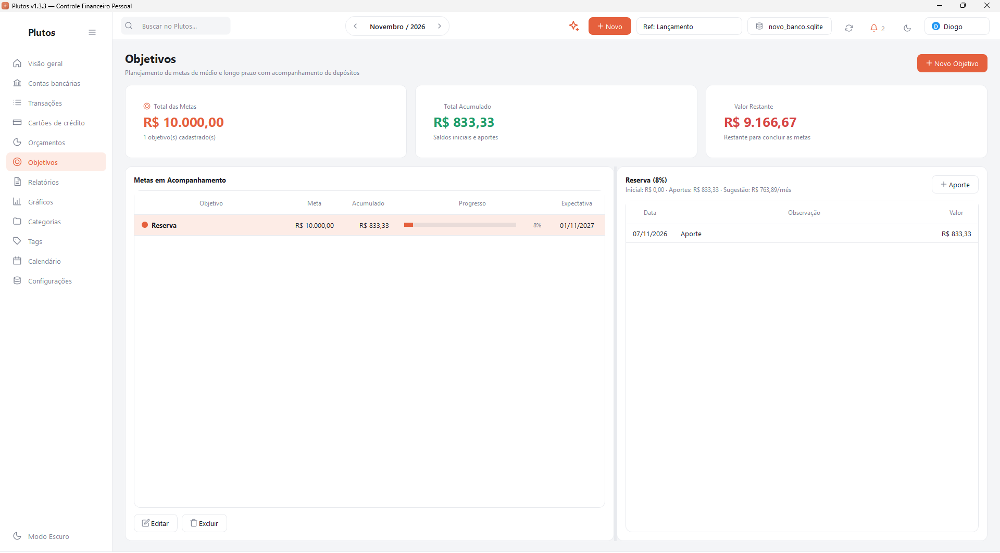
        <p align="center"><b>Metas e Objetivos</b></p>
      </td>
      <td width="50%">
        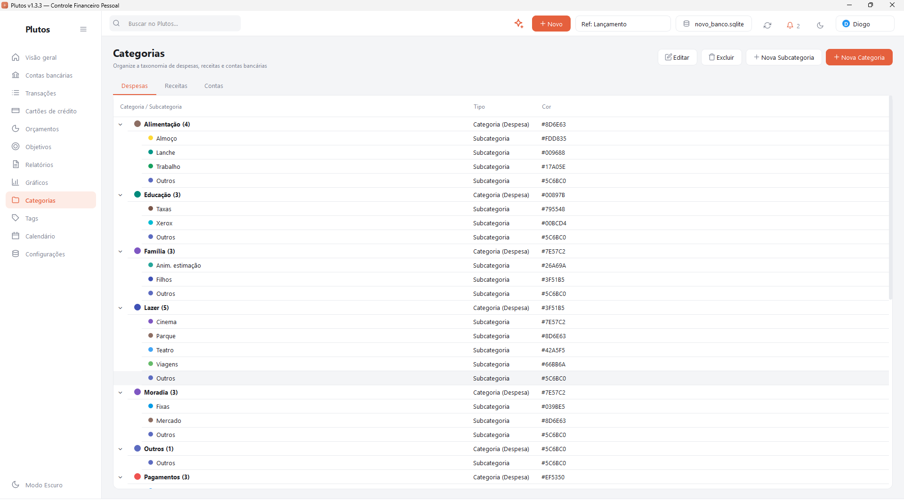
        <p align="center"><b>Categorias e Subcategorias</b></p>
      </td>
    </tr>
    <tr>
      <td width="50%">
        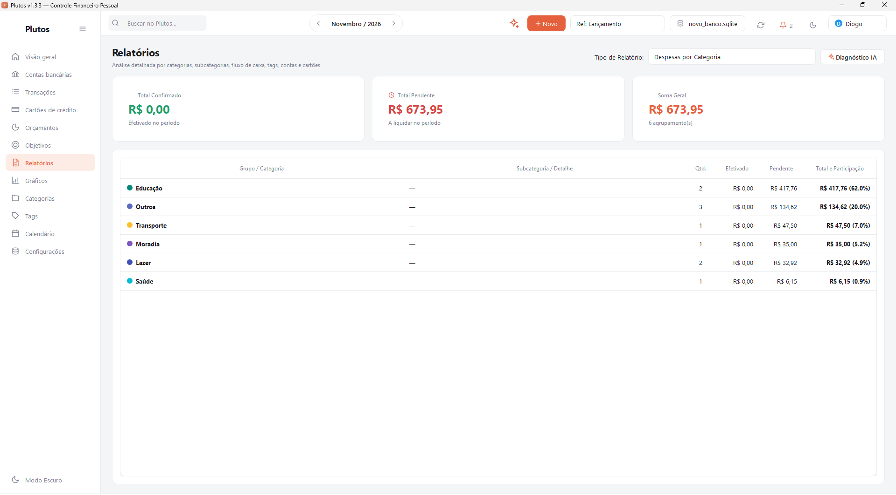
        <p align="center"><b>Relatórios e Diagnóstico 50-30-20</b></p>
      </td>
      <td width="50%">
        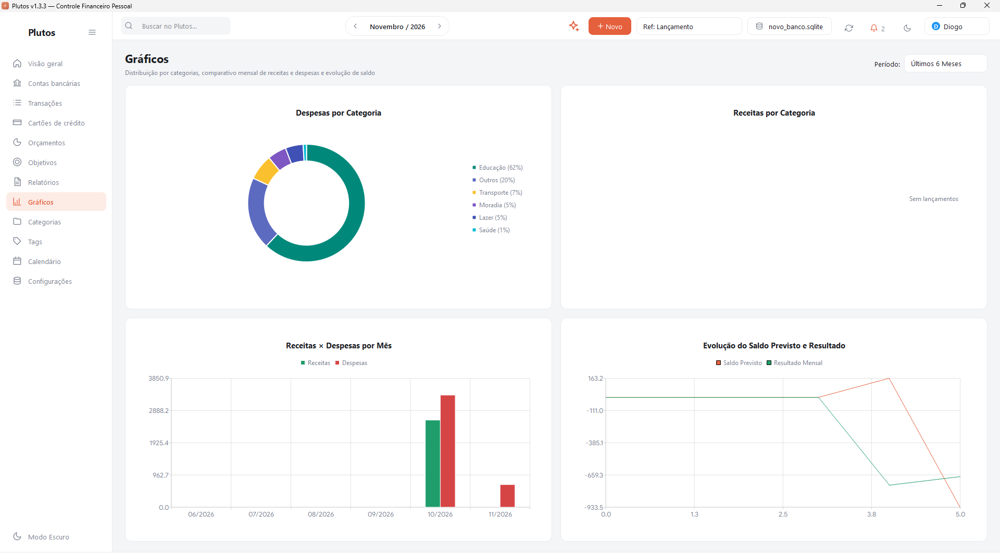
        <p align="center"><b>Gráficos Analíticos (QtCharts)</b></p>
      </td>
    </tr>
    <tr>
      <td width="50%">
        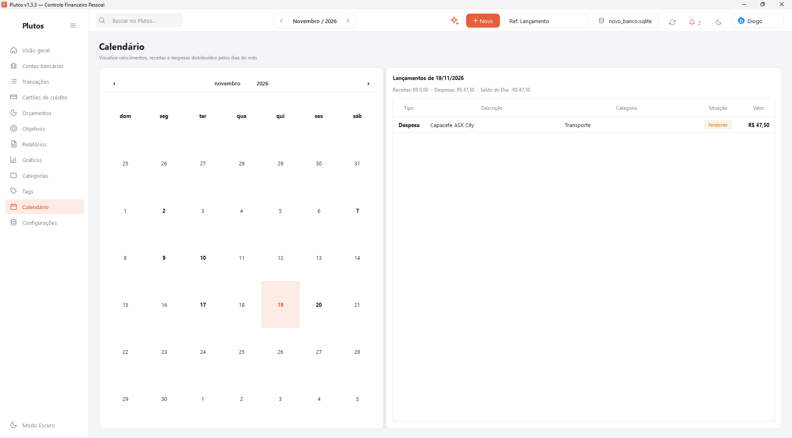
        <p align="center"><b>Calendário de Vencimentos</b></p>
      </td>
      <td width="50%">
        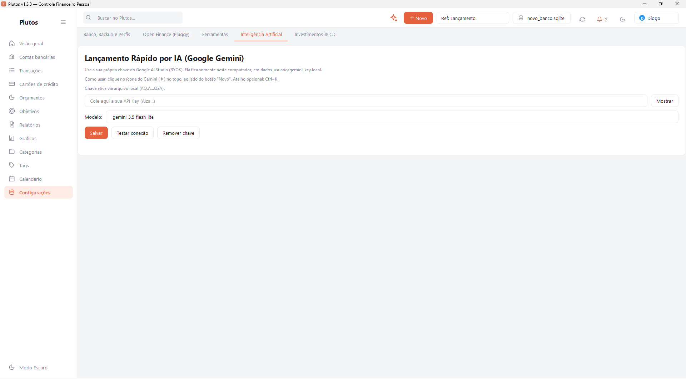
        <p align="center"><b>Configurações e Chaveiro de IA</b></p>
      </td>
    </tr>
    <tr>
      <td colspan="2" align="center">
        
        <p align="center"><b>Interface no Modo Escuro</b></p>
      </td>
    </tr>
  </table>
</div>

---

## Arquitetura do Projeto

Estrutura de diretórios com separação em camadas:

```text
Minhas Finanças/
├── app/
│   ├── assets/                 # SVGs, ícones e fontes locais
│   ├── config/                 # Configurações gerais, chaveiro de IA e temas (QSS)
│   ├── database/               # Conexões SQLite, migrations e rotinas de backup
│   │   └── repositories/       # Repositórios de dados (contas, categorias, tags, perfis)
│   ├── domain/                 # Entidades e modelos de domínio
│   │   └── services/           # Regras de negócio (transações, cartões, relatórios, IA)
│   ├── io_module/              # Importação/exportação CSV/Excel e anti-duplicação SHA-256
│   ├── services/               # Clientes externos (Google Gemini REST, Pluggy)
│   ├── ui/                     # Interface gráfica em PySide6
│   │   ├── components.py       # Widgets reutilizáveis (cards, badges, botões)
│   │   ├── style_manager.py    # Gerenciador de temas dinâmicos (Light / Dark)
│   │   ├── dialogs/            # Modais (lançamento por texto, edição de fatura, etc.)
│   │   └── views/              # Telas da aplicação (dashboard, cartões, contas, etc.)
│   ├── main.py                 # Ponto de entrada da aplicação
│   └── version.py              # Versão do sistema
├── dados_usuario/              # Diretório local para bancos SQLite e backups (ignorado no Git)
├── docs/                       # Documentação técnica
├── installer/                  # Script do instalador Windows (Inno Setup 6)
├── referencias/                # Capturas de tela da aplicação
├── scripts/                    # Scripts utilitários de QA e auditoria de interface
├── tests/                      # Suíte de testes automatizados com pytest
└── build_executable_and_installer.ps1 # Script de automação de build e empacotamento
```

---

## Instalação e Execução

### Pré-requisitos
- Python 3.10, 3.11 ou 3.12 ([Download oficial](https://www.python.org/))
- Git

### Passos

```powershell
# 1. Clonar o repositório
git clone https://github.com/diogold01/plutosfinances.git
cd plutosfinances

# 2. Criar e ativar o ambiente virtual
python -m venv .venv
.\.venv\Scripts\Activate.ps1

# 3. Instalar dependências
pip install PySide6 openpyxl pytest

# 4. Iniciar a aplicação
python -m app.main
```

---

## Testes Automatizados

A suíte conta com 97 testes automatizados cobrindo regras financeiras, persistência, cálculo de CDB, mocks de API e renderização de interface em modo offscreen:

```powershell
py -m pytest -v tests
```

---

## Build e Empacotamento Windows

Para gerar o executável standalone (`.exe`) via PyInstaller e o instalador via Inno Setup 6:

```powershell
# Instalar PyInstaller
pip install pyinstaller

# Gerar executável e instalador
powershell -ExecutionPolicy Bypass -File .\build_executable_and_installer.ps1 -Version "1.3.6"
```

Os binários serão gerados em:
- `dist/Plutos/Plutos.exe` (Executável standalone)
- `dist/Instalador/Plutos_Setup_1.3.6.exe` (Instalador para Windows)

---

## Licença

Distribuído sob licença de uso pessoal e educacional.
